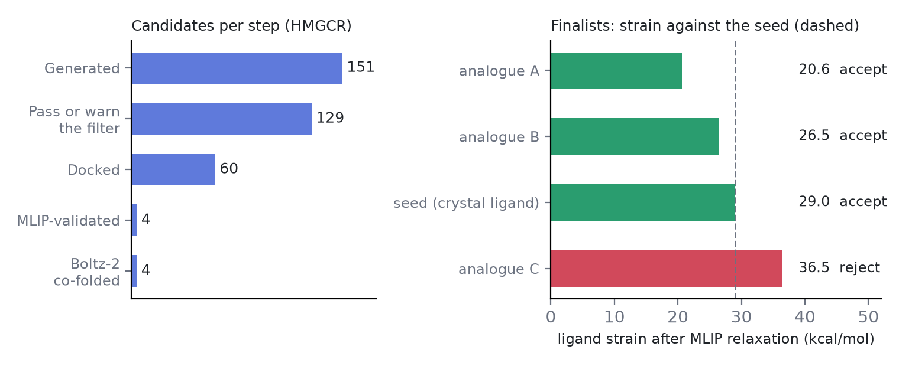

# CafChem MedRAg: a self-checking hit-to-lead agent

**Mauricio Cafiero** · code: https://github.com/MauricioCafiero/MedRAg · MIT license

## The problem
Generative models propose molecules quickly, but a medicinal chemist still has to ask whether each one is plausible: does it pass drug-likeness and ADMET filters, does it dock into the right pocket, and is the docked pose physically reasonable? These checks usually live in separate tools and are done by hand.

## What MedRAg does
Given a protein name (or a structure with a co-crystallized ligand) and a seed molecule, MedRAg runs one pipeline and writes an HTML report:

1. **Discover**: UniProt and RCSB give the best structure, its bound ligand and the seed.
2. **Generate**: analogues from three sources: a BERT mask/unmask model (GenMask), shape-matched bioisostere swaps, and a small GPT fine-tuned on the target's ChEMBL IC50 molecules (or PubChem neighbours of the seed).
3. **Filter**: pH 7.4 protonation, unrealistic-motif check, QED, Lipinski, PAINS and ADMET-AI.
4. **Dock and site check**: AutoDock Vina, then a contact check that asks whether a pose reproduces at least half of the crystal ligand's residue contacts.
5. **Validate**: the pocket is cut out, relaxed with a machine-learned interatomic potential (MACE-POLAR-1), and each pose is checked for strain, clashes, residual forces and lost contacts. Strain is graded relative to the seed.
6. **Boltz-2 (optional)**: the finalists are co-folded on a Modal GPU, giving an independent predicted complex and affinity (about 2.5 minutes and a few cents per molecule).

It runs from the command line, or an LLM agent (Ollama cloud or Anthropic) can drive every step through tool calls with a planner and reviewer pass. Each step saves its results, so an interrupted run resumes where it stopped. Everything except the optional agent and Boltz step runs locally on a CPU, with no account or key.

## Result on HMGCR (PDB 1HWL, bound ligand FBI)
From the seed, 151 candidates were generated (100 bioisostere, 33 GenMask, 21 GPT). Of these, 53 passed the filter and 76 passed with warnings, and the best 60 were docked (best Vina −8.6 kcal/mol, seed −8.2). The seed and three candidates went through MLIP validation: two candidates were accepted, one rejected for strain (36.5 kcal/mol against the seed's 29.0). The least-strained candidate (20.6) also had the highest Boltz-2 score (pIC50 5.4, binder probability 0.48).

## What we learned
On SULT1A3 (dopamine site), neither Vina scores nor the MLIP feasibility checks separated poses in the right site from poses in the wrong one. The residue-contact check did: right-site poses reproduced 0.71 to 1.0 of the crystal contacts, wrong-site poses 0 to 0.29, in agreement with a centroid-distance test on all 105 poses. The pipeline therefore filters on the contact check before spending MLIP time on a pose, and the report says plainly that the MLIP stage is a sanity filter, not a rescoring.

## Limits
- This is a computational triage, not evidence of activity: no candidate has been synthesized or assayed.
- Boltz-2 gave the known HMGCR ligand a binder probability of only 0.28, so it is best read as a second opinion alongside docking and strain, not as a ranking.
- Only SULT1A3 and HMGCR have been run end to end, and only on Linux.

## Built on
GenMask, bioisostere_assist, MoDrAg_CLI, dock_assist, UMADock, cafprot and FAO_MOLPROP_CLI (the author's own repos, copied into the project with their licenses), plus Boltz-2, AutoDock Vina, MACE, RDKit and ADMET-AI.
